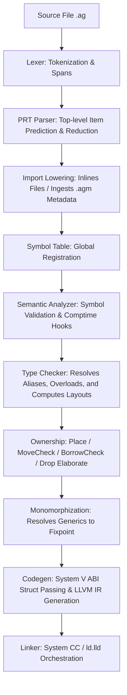

# Silver compiler reference

> **Layout note (bootstrap migration):** the Rust toolchain lives under
> `bootstrap/`; the Silver self-host workspace is split into the `bin/agc`
> driver and the reusable `libs/agc` frontend library. All `cargo` commands
> still run from the repo root; `cargo build -p agc` builds the stage0
> bootstrap from `bootstrap/stage0/agc`.

This reference describes the Rust stage0 pipeline and the ownership and runtime contracts the Silver stage1 compiler must preserve. Read [AGENTS.md](../AGENTS.md) for working rules and [SYNTAX.md](../SYNTAX.md) for current syntax. Verify implementation details against source and tests when changing a pass. A stage0 capability described here is not evidence that stage1 implements it.

---

## 1. Project Overview

Silver is a statically typed, LLVM-backed systems programming language exploring a design space between raw C-level control and modern ergonomics.

### Core Architecture Goals
- **Ownership**: Use `move expr` for explicit ownership transfers. The compiler also analyzes implicit move/copy sites; consult `SYNTAX.md` and ownership tests for the rules. Prefer borrow receivers for caller-owned state and raw pointers for FFI or manual memory access.
- **Deterministic Resource Management (RAII)**: Scoped cleanup through the `Drop` trait and compiler-generated drop flags, allowing deterministic object destruction on block exit.
- **Zero-Cost Abstractions**: Generics monomorphize at compile-time to concrete struct/enum layout configurations and mangled function symbols.
- **Packaged Module Resolution**: Packages can be imported as source files (which are inlined) or loaded as binary metadata modules (`.agm` artifacts).

---

## 2. Repository Structure

```
silver/
├── silver.toml                  # Silver workspace manifest (self-host root)
├── bin/agc/                     # Stage1 Silver compiler driver
│   └── src/agsm.ag               # AGSM command integrated into agc
├── bin/aglsp/                   # Silver language-server package
├── libs/agc/                    # Reusable Stage1 Silver compiler library
├── bootstrap/                   # Rust bootstrap (stage0) — the pre-self-host toolchain
│   ├── stage0/
│   │   ├── agc/                 # The Silver compiler source code (Rust crate, uses Elise)
│   │   │   ├── src/
│   │   │   │   ├── main.rs          # Compiler driver, CLI options parsing, and build orchestrator
│   │   │   │   ├── lib.rs           # Exported bootstrap compiler modules
│   │   │   │   ├── lexer.rs         # Token definition, lexical scanner, and spans
│   │   │   │   ├── parser/          # Syntactic analysis and import resolution
│   │   │   │   ├── semantic/        # Semantic analysis, type checking, and monomorphization
│   │   │   │   │   ├── place.rs          # Place {local, projections} — structural location
│   │   │   │   │   ├── move_path.rs      # MovePathTree + InitState (Partial/Init/Uninit)
│   │   │   │   │   ├── init.rs           # move_out / copy_from / initialize / read
│   │   │   │   │   ├── type_properties.rs # TypeProperties {is_copy, needs_drop}
│   │   │   │   │   ├── drop_elaborate.rs # Drop elaboration + hybrid flag plan
│   │   │   │   │   ├── move_check.rs / borrow_check.rs # Place-based analyses
│   │   │   │   ├── symbol_table.rs  # Phase-aware compiler symbol registration & scopes
│   │   │   │   ├── diagnostics/     # Centralized message catalog and error visualizer
│   │   │   │   └── profiler.rs      # Phase timing instrumenter
│   │   │   └── Cargo.toml
│   │   ├── agsm/                # Bootstrap source maps/module artifact generator
│   │   └── ffi-rust/            # Optional Rust implementation behind Silver's versioned C ABI
├── target/                      # Default Rust build output (cargo)
├── std/                         # Silver standard library sources
│   ├── mem/                     # Allocator, smart pointers (Box, Rc, Vec, Arena)
│   ├── rt/                      # Pure-Silver runtime: GC heap, type system, casts, method dispatch
│   └── ops.ag                   # Core arithmetic and index operator overloading traits
├── examples/                    # Silver example applications (.ag files)
├── tests/                       # Standard-library behavior suite
└── scripts/                     # Packaging and release scripts
```
> **External Dependency**: Parsing engine libraries (`elise-core`, `elise-lex`, `elise-parse`, `elise-grammar`) are maintained in the standalone repository [**CierCier/elise**](https://github.com/CierCier/elise).

---

## 3. Build & Test

### Development Commands

1. **Build the Compiler**:
   ```bash
   cargo build -p agc
   ```
2. **Run the Stdlib Suite**:
   ```bash
   python3 tests/run_tests.py --no-tui --jobs 4
   ```
3. **Compile a Silver file**:
   ```bash
   cargo run -p agc -- path/to/file.ag -o out
   ```
4. **Fast Frontend-Only Typecheck (`agc check`)**:
   ```bash
   cargo run -p agc -- check path/to/file.ag
   ```
5. **Compile and Run (`agc run`)**:
   ```bash
   cargo run -p agc -- run path/to/file.ag [args...]
   ```

---

### Native target contract

Stage1's native backend uses the triple returned by
`LLVMGetDefaultTargetTriple()` for its LLVM target machine. The supported
runtime and linker path is x86_64 Linux. Omitting `--target` selects this host
path. An explicit target must match the LLVM default triple exactly, including
its vendor and environment components. The error reports the supported triple.
Aliases and different ABI environments are not treated as equivalent.

The restriction covers native source and workspace build/run commands, including
object and module emission. Unsupported targets fail before source compilation
and output creation so that target-specific cfg cannot select code
for a different machine than the backend emits. Program arguments forwarded by
`run ... --` or `--run-arg` are not compiler target options.

Source and workspace `check` commands retain target-dependent cfg selection.
`lex`, `parse`, and `ast` accept `--target` but dump the unfiltered source; they
do not apply target cfg. Neither checks nor dumps prove that a program can be
compiled or linked for that target. Stage0's cross-target implementations are
separate and unchanged.

The [native driver](../bin/agc/src/native_backend.ag) implements this contract.
The option audit below describes the other native driver boundaries.

### Native options

Audited on 2026-10-18 against the native driver based on `962ed91`, including
the host-target guard committed as `64dfb27`. This is the stage1 `build`/`run` contract,
not the Rust stage0 CLI contract. The [schema](../bin/agc/src/cli.ag) accepts
more options than the [native backend](../bin/agc/src/native_backend.ag)
implements. An accepted spelling alone does not establish behavior.

| Option or command | Observed native behavior and scope |
| --- | --- |
| `--help`, `-h`, `--version`, `-V` | Print the stage1 help/version and exit. |
| `build`/`b`, `run`/`r`, direct source paths | Build native code; `run` executes the result. Use the command form rather than hidden `--run`. |
| `check`/`c`, `lex`, `parse`, `ast` | Local frontend commands. `check` has partial typed checking; syntax acceptance is not a complete semantic guarantee. |
| `--manifest PATH`, `--bin NAME`, `--lib NAME` | Select supported package/workspace targets. Git dependencies remain unsupported. See the [workspace implementation](../bin/agc/src/workspace.ag). |
| `-o FILE`, `--output FILE`, `--output=FILE` | Select the output path. |
| `--emit=exe` or no emit option | Produce an executable. |
| `--emit=object` or `--emit object` | Produce an ELF relocatable object. The advertised `--emit=obj` and `-c` currently produce executables instead. |
| `--emit=module` | Produce frontend AGM metadata plus its native object. Rich ABI/layout metadata parity remains open. `--shared` does not select shared native output. |
| `-S`, `--emit-asm`, `--emit-llvm`, other `--emit` values | No requested-mode handling. `asm`, `llvm-ir`, `check`, `tokens`, `ast`, and `grammar` fall back to executable output on `build`. Use the frontend commands for checking and dumps. |
| `-I DIR`, `-IDIR`, `--include DIR`, `--include=DIR`, `--include-path DIR` | Add source import roots. `--root DIR` is accepted but does not set a native import root. |
| `--target TRIPLE` or `--target=TRIPLE` | Exact LLVM host triple only for native output, as described above. |
| `--cfg KEY=VALUE,...` | Add cfg values; repeated flags are accepted. Explicit cfg values can coexist with derived values. |
| `-O`, `-O LEVEL`, `-O1`/`2`/`3`/`s`/`z`/`fast`, `--opt-level LEVEL`, `--opt-level=LEVEL` | Native builds apply the stage0 IR pass sequence and select the corresponding target-machine codegen level. Bare `-O` means level 2. Nonzero levels select release cfg and prune debug assertions; `-O0` retains debug cfg and skips the IR pass sequence. Invalid levels fail before source compilation. Size and `fast` spellings currently follow stage0's limited pass mapping, not full LLVM size pipelines or fast-math semantics. |
| `-g`, `--debug-info`, `-g0`, `--g0` | Accepted without native DWARF generation or suppression. The debug cfg flag controls assertions, not DWARF. |
| `--leak-check` | Accepted without enabling native allocator instrumentation. The generated `__silver_leak_check_enabled` global remains false. |
| `-L DIR`/`-LDIR`, `-l LIB`/`-lLIB`, `--static` | Forward native library/search/static-link inputs. Long `--library-path`, `--lib-path`, and `--library` spellings are accepted but not forwarded. |
| `-Wall`, `-Wextra`, `-Wunused`, `-Wunreachable-code`, `-Werror`, their implemented `-Wno-*` forms | Configure the selected entry-file lints. The [lint configuration](../libs/agc/src/frontend/lint.ag) enumerates the supported spellings; unknown warnings and long `--warning` forms have no effect. |
| `-j N`, `--jobs N` | Require a positive worker count and bound native module workers. |
| `--no-cache`, `-nc`, `--cache-dir DIR` | Bypass native object caching or select its directory. Dependency-local invalidation and full artifact reproducibility remain open. |
| `cache info`/`prune`/`clean`, `clean`, `--clean`, `--clean-cache`, `--cache-info`, `--cache-prune` | Inspect or remove native object cache entries; not package initialization. |
| `--progress`, `--no-progress`, `-v`/`--verbose`, `--profile` | Control build progress, details, and phase profiling. |
| `--run-arg ARG`, program arguments after `--` | Forward program arguments for `run`. They do not select compiler target cfg. |
| `--static-runtime` | Accepted for the existing static Silver runtime; it does not select a second runtime implementation. |
| `--tree-shake`, `--no-tree-shake`, `--dry-run`, `-###`, `--show-graph` | Accepted without the promised behavior. In particular, a native dry run still creates an executable. |
| `--sysroot`, `-D`/`--define`, `--no-std` | Accepted without applying a native sysroot, preprocessor definitions, or standard-runtime exclusion. |
| `--check`, `--run`, `--test`, `--test-harness`, `--nocapture` | Accepted without selecting those native build behaviors. Workspace `test`/`t` explicitly reports unsupported; use the integration harness for tests. |
| `init`, `--init`, `--name` | Recognized by the CLI but no working stage1 package initialization path is implemented. `--name` on a native build has no effect. |
| `agsm` | Own CLI/help and local rejection of unsupported foreign-module generation; it does not invoke a bootstrap generator. |

The audit used executable exit codes for cfg and option probes, ELF type
inspection to distinguish objects from executables, section inspection for
DWARF, and runtime reads of the allocator flag. For example, compiling this
program with `--leak-check` returned 43 under stage0 and 42 under stage1:

```silver
import std.mem.alloc;

i32 main() {
    if (__silver_leak_check_enabled) { return 43; }
    return 42;
}
```

These gaps remain compiler work. [C06](https://github.com/CierCier/silver/issues/36)
tracks native artifacts and option behavior; [C04](https://github.com/CierCier/silver/issues/34)
tracks ownership and cleanup proof. Passing fixtures with an ignored leak flag
does not establish allocator leak freedom. Neither C01 documentation nor
parser acceptance closes those correctness gates.

The [native optimization implementation](../libs/agc/src/backend/llvm/optimization.ag)
applies LLVM IR passes before object emission.
With no optimization flag, native stage1 uses LLVM's `Default` machine-codegen
level without running IR optimization; stage0 instead uses `None`. Explicit
`-O0` uses `None` in both stages and retains debug cfg. Record the exact flags
when comparing compile times; an omitted `-O` is not equivalent to `-O0` across
stages. This does not establish binary size or performance parity; reachability
and artifact work remain open. Scalar local storage is allocated in the entry
block so LLVM can promote it even when the declaration follows control flow.
Initialization stays at the declaration; aggregate allocation behavior is
unchanged. Verbose profiles report LLVM optimization separately from object emission.

## 4. Compiler Pipeline



### Detailed Compiler Stages

#### 1. Lexer (`lexer.rs`)
- Depends on the [**Elise**](https://github.com/CierCier/elise) parsing engine (`elise-core`, `elise-lex`) for token extraction, span tracking, and lexical streaming.
- Scans raw text into a flat vector of `LexToken` containing the enum token type, exact character spans, and lexed text.
- Supports multi-character tokens, complex numbers (e.g. `3.5i`), escape sequences, and keyword mapping.

#### 2. Parser (`parser/prt_parser.rs`)
- Built on the [**Elise**](https://github.com/CierCier/elise) grammar/reduction framework (`elise-parse`, `elise-grammar`) as a **Predictive Reduction Table (PRT) Parser**.
- Looks ahead at the start of top-level blocks to map tokens to `TokenClass` (e.g., `Struct`, `Enum`, `Impl`, `TypeStart`) and predicts which `ItemProduction` to instantiate.
- Finds item boundary segments (`find_item_end`) and executes a specialized reduction parser block on that slice of tokens.

#### 3. Import Lowering (`parser/import_hook.rs`)
- Resolves module import directives (`import std.io;`) recursively:
  - **Source File Imports**: The target `.ag` file is parsed, its imports recursively lowered, and its AST items are **fully inlined** into the importing program's item list.
  - **Precompiled Module Imports**: Reads compiled `.agm` binary artifacts (current writer header `AGM\x00\x00\x0B`; stage1 also validates the supported v2/v6-v10 layouts). These exports are cached as type signatures in `module_imports` and not merged directly into the AST items.

#### 4. Symbol Table Init (`symbol_table.rs`)
- Registers top-level functions, structs, globals, and traits.
- Tracks phase-based transitions (`CompilerPhase`) and maintains scopes for local variables.

#### 5. Semantic Analyzer (`semantic/analyzer.rs`)
- Performs static checks (checking for duplicate symbols and validating declaration formats).
- Runs `SemanticAnalyzerHook` steps, such as `ComptimeCastHook`, which folds constant casts (e.g. `comptime (i32) 3.9` into `3`).

#### 6. Type Checker (`semantic/typeck.rs`)
- Calculates struct memory layouts (System V / C structure alignment).
- Enforces trait bounds and matches type signatures.
- Maps arithmetic/logical expressions to overloaded methods (traits like `Add`, `Eq`, `IndexedAccess` in `std.ops`) by searching for double-underscored matching functions (e.g., `__add`, `__index_get`).
- Generates type error reports and compiles `MonomorphRequest` generics requests.

#### 7. Ownership (`place.rs` / `move_path.rs` / `init.rs` / `type_properties.rs` / `move_check.rs` / `borrow_check.rs` / `drop_elaborate.rs`)
- `Place {local, projections}` with `is_prefix_of` / `overlaps` (Index `v[i]` vs `v[j]` conservative, `v` overlaps `v[i]`).
- `TypeProperties {is_copy, needs_drop}`: primitives/ptr/all-Copy struct = Copy, `String`/`Vec`/`HashMap`/`HashSet`/`Deque` = Move.
- `MovePathTree` + `InitState` + `move_out`/`copy_from`/`initialize`/`read`; field-granular `x.a` vs `x.b`, reinit `x.a = make()`.
- `Borrow {place, kind}` via `places_overlap`.
- `init_plan.rs` carries typed owner layouts and resolved places from move
  analysis to LLVM. Concrete generic instances complete their plans through the
  same semantic layout resolver. The native frontend uses `init_plan.ag` and
  returns owner plans with its ownership result.

#### 8. Monomorphization (`semantic/monomorph.rs`)
- Runs a fixpoint generation loop:
  - Discovers template types (structs, enums, impls, functions) matching type signatures in `MonomorphRequest`.
  - Replaces type variables with concrete types and mangles the new struct/method names.
  - Instantiates nested generic calls inside monomorphized code to fixpoint.

#### 9. Codegen (`codegen/llvm_ir/`)
- Leverages the `inkwell` LLVM bindings wrapper.
- Interfaces with target machine layouts via `codegen/abi.rs`, classifying struct layouts <= 8 bytes, <= 16 bytes, and > 16 bytes according to System V AMD64 ABI specifications.
- Translates syntax constructs (variables, scopes, defer blocks, drop flags, and inline `asm`) into native LLVM IR code.

#### 10. Linker (`main.rs` link driver)
- Compiles generated LLVM IR into temporary object files.
- Invokes target toolchains (system `cc` or `ld.lld`) to perform symbol resolution, linking in required library dependencies and producing executables or shared libraries.
---

## 5. Coding Style & Conventions

- **Compiler Implementation (Rust)**:
  - Avoid duplicate semantic checks; separate parsing/lowering and typecheck/codegen.
  - Keep pipeline passes strictly isolated. No code generation or type resolution should occur during parsing.
  - Maintain absolute correctness in target data layouts. Do not guess structure alignments.
- **Silver Language Idioms**:
  - Struct constructors are standard static methods returning a moved instance:
    ```silver
    Rc<T> new(T val) {
        // ...
        return move rc;
    }
    ```
  - Instance methods take the receiver as the first argument. Borrow receivers are preferred for caller-owned state; raw pointers remain available at FFI and manual memory boundaries:
    ```silver
    T* get(&Rc<T> self) {
        return self.ptr;
    }
    ```

---

## 6. Memory & Ownership Conventions

The compiler tracks initialization of local owned places and uses that state
for overwrite and scope-exit cleanup.

### Critical Invariants

1. **Automatic Field Cleanups**:
   - The compiler automatically drops struct fields after the struct's own `drop` method returns.
   - Struct `drop` methods do NOT need to explicitly call `drop()` on fields — the compiler handles this.
   - Consuming an owned field beneath a value with its own `Drop` is rejected,
     including nested fields. Whole-value moves and Copy field reads are allowed.
   - The `drop` method is for cleaning up non-field resources (e.g., freeing pointers, closing fds).
     ```silver
     impl Drop for HasInner {
         void drop(*self) {
             outer_drop_count = outer_drop_count + 1;
         }
     }
     ```
2. **Pointer/Reference Exemption**:
   - The compiler only tracks ownership and emits destructors for value-type variables.
   - Pointers (`T*`) and reference types are assumed to be non-owning views and are never automatically dropped.
3. **Explicit Move Semantics (`move`)**:
   - Marking a variable transfer with `move x` invalidates the local resource inside the caller's stack frame.
   - Each tracked local has one tree of initialization nodes. Nodes hold parent
     and child links and a state byte: `Uninit = 0`, `Partial = 1`, `Init = 2`.
     LLVM's target layout determines storage alignment and field addresses.
   - A move marks the source subtree uninitialized and recomputes ancestor
     states. Direct assignment initializes the target subtree after the store.
4. **Deferred Cleanup Stack (`defers`)**:
   - Scope exit drops are placed on a deferred stack.
   - Cleanup skips `Uninit`. A full value runs its own destructor and then its
     field cascade. A partial value skips its own destructor and cleans only
     initialized descendants in declaration order.
5. **Return and Exit Handling**:
   - When executing `return expr;`, the compiler evaluates the expression value first, saves it in a temporary register, runs all pending `defers` up to the function scope level, and then issues the final return instruction. This avoids use-after-free conditions.
   - By-value owned parameters begin initialized. Uninitialized local declarations
     begin empty; declaration execution resets their state on each loop entry.
6. **Inline Owner State**: plans include every required inline child, including
   scalar and Copy fields. A struct's own destructor cannot run until all those
   fields are initialized. Legacy native flag handles alias these state bytes;
   they do not maintain separate liveness. Copy-only locals need no runtime
   cleanup tree. Direct local overwrite cleans the target subtree before the
   replacement store. Pointer/reference edges stop the tree: references do not
   yet transport this metadata, and indirect owned-field overwrite cleanup
   remains unimplemented. Heap containers retain their own mutation contracts.
   The native backend shares a read-only node-layout table for each concrete
   type in a module. Node initialization and whole-tree state changes emit
   bounded loops rather than a store sequence for every inline child.
7. **Enum Payload Ownership**: constructing a variant with an owned payload requires `move` (`Res.Ok(move i)` — a bare `Res.Ok(i)` is a compile error). Enums WITHOUT a Drop impl of their own get a tag-aware payload cascade: the active variant's Drop-typed payload is dropped at scope exit (so a never-unwrapped `Result<Owned, E>` does not leak). Extract owned payloads with a `move` binding — `match r { Ok(move v) : v, ... }` — which transfers ownership and zeroes the enum's slot (freeing via a plain binding copy now double-frees, since the cascade still runs). Enums WITH a Drop impl manage their payloads in the drop body and get no cascade.
8. **Place & Overlap**: `Place {local, projections=[Field/Index/Deref]}` with `is_prefix_of` (x is prefix of x.a) and `overlaps` (x overlaps x.a, x.a vs x.b disjoint, `v` overlaps `v[i]`, `v[i]` vs `v[j]` conservative). Borrow/move/init/drop all share this.
9. **Copy vs Move**: `TypeProperties {is_copy, needs_drop}` distinguishes reads
   that preserve a source from transfers that invalidate it. Copy classification
   does not remove scalar children from an owned parent's initialization plan.

### Lambda lowering

Arrow lambdas use `(parameters) => expression` or `(parameters) => { statements }`
with the capture rules in [SYNTAX.md](../SYNTAX.md#lambdas).
Stage0 checks lambda bodies with a separate return context and lowers them after
type checking in `semantic/typeck/lambda.rs`. The native frontend converts them
before name resolution in `frontend/lambdas.ag`, using the existing expression
checker to infer parameter contexts, returns, and capture access.

Stage0 keys lambda replacements and capture bindings by span. Macro expansion
copies body spans, so it also tags copied nodes with `Span::expansion`: one id per
expansion of the macro body, and a fresh id for each substituted argument copy,
preserving any distinct ids already inside the argument.

Both paths generate private functions and ordinary capture structs. Reads borrow
captured locals, writes borrow them mutably, and consuming non-Copy state moves
it into the environment. Consuming calls transfer the environment by value.
The regular ownership, layout, and cleanup passes handle the generated items;
capture structs need no custom destructor. Borrowed environments must not escape
their sources, and aliases retain the underlying capture loans.

`examples/lambdas.ag` demonstrates the supported forms. The existing collection
drop-glue fixture checks owned Vec captures and transfers, and the HTTP server
fixture exercises the local routing predicates in `std.net.http`. Generic
lambda scopes and capturing callbacks through generic callable APIs remain
unsupported.

## 7. Diagnostics

Compiler diagnostic messages are rendered using the `diagnostics::render` utility.
- **Centralized message catalog**: every user-facing diagnostic string lives in `bootstrap/stage0/agc/src/diagnostics/messages.rs` as a named function (`msg::unknown_identifier`, `msg::type_mismatch`, `msg::use_of_moved_value`, ...). Passes import `crate::diagnostics::messages as msg` and call catalog functions instead of inlining literals — editing/translating messages is a single-file change.
- Formatting reports: `error: file:line:col: message` or `warn: file:line:col: message` followed by the source line text and carets (`^`) pointing precisely to the span (with automatic tab expansion for character alignment).
- Severity levels are defined by the `Severity` enum (`Error`, `Warning`, or `Note`).
- **Multi-Span Move Diagnostics**: `move_check` records the original move site and reason, rendering a secondary `note: file:line:col: value explicitly moved here` under use-after-move errors.
- **Compiler Warning System & Linter**: Configured via `-Wall`, `-Werror` (treat warnings as errors), `-Wunused`, `-Wunreachable-code`, and `-Wno-*` flags. Detects unused variables/parameters (suppressed with `_` prefix) and unreachable statements following unconditional returns/breaks/continues.
- **Fuzzy Typo Suggestions ("Did you mean ...?")**: Levenshtein distance matching generates suggestion suffixes (`did you mean '...'?`) across unknown identifiers, struct fields, methods, types/enums, traits, and compiler-builtin macros.
- **In-Memory Formatting (`@format`)**: Builtin macro `@format("...", args...)` builds a formatted heap string into an owned `String` instance.
- **Native Silver LSP**: `libs/agc/src/tooling/index.ag` records declarations, lexical scopes, and identifier occurrences for `bin/aglsp`. The native server provides parameter and type hints and checks lexer-token preservation before formatting. See [native LSP setup, capabilities, and limits](language-server.md).
## 7.1 Debugging Support (DWARF by default)

DWARF is emitted by default for non-release builds (no `-O` / `-O0`) and
stripped for release builds (`-O1+`). `-g` forces it on, `-g0` (normalized
to `--g0` by the `main.rs` shim — clap shorts are single characters) forces
it off; an explicit flag always wins.

Full DWARF (not just line tables):
- Basic types (ints, floats, bool, char, str), pointers, arrays, and struct types with member offsets; recursive structs are cycle-guarded (members referencing the type under construction fall back to `u8*`).
- `DILocalVariable` + `llvm.dbg.declare` records for parameters, let bindings, range/iterator for-loop bindings, and enum payload match bindings — gdb can `print` locals, inspect struct fields, and watch variables. Enum values themselves have no DWARF mapping (prints as raw bytes); pointers to enums show as `u8*`.
- Multi-file source maps: spans from inlined `std/`/imported files resolve against their own `DIFile`/`SourceMap` in `DebugContext.files`, so breakpoints inside std code hit at the right file/line.
- Generic instances emitted lazily mid-codegen (`Vec::drop`, `realloc<T>`, ...) are suppressed from debug output (LLVM 22's DbgRecord DIE construction crashes on their dangling scope chains); their enclosing function's debug state is saved/restored around the emission (`debug_nested` flag). Lexical blocks are tagged with their owning subprogram so they never leak into another function's scope chain.
- **LLVM 22 invariants (all three crash the backend if violated):** (1) a `DILexicalBlock` may never be parented to the compile unit — it materializes as a broken `scope: null` node and ISel's `LexicalScopes::scanFunction` segfaults, so `push_lexical_block` returns false (callers skip the matching pop) when `current_scope()` is the CU; (2) a `DILocation` must never be scoped to the CU (`DwarfDebug::finishEntityDefinitions` dies in `DIE::getUnitDie`), so `set_debug_location` is a no-op while `debug_nested`; (3) nested lazy emissions must save/restore both `debug_nested` and `current_subprogram` — an inner instantiation otherwise leaves the outer function with a None subprogram and its remaining variables get invalid CU-scoped debug info. The full integration suite compiles with DWARF on by default, and `opt -passes=verify` on the emitted IR is clean.
- Every function carries the `"frame-pointer"="all"` attribute so the runtime backtrace walker can follow the rbp chain at any opt level.

## 7.2 Runtime Backtraces

The compiler emits a link-time-resolved symbol table for every function with a body:
- `@__silver_bt_entries` (linkonce_odr, pointer to a private `[N x {i64 addr, u8* name}]` array; `addr` is `ptrtoint(ptr @F to i64)` in a global initializer, resolved by the linker) and `@__silver_bt_count`.
- `linkonce_odr` dedups the table when .agm library objects are linked into a consumer — the application's own copy (first in link order) wins, so its addresses match the final binary.
- `std/rt/backtrace.ag` walks the rbp chain (inline asm reads rbp), resolves each return address to the entry with the largest `addr <= ret_addr`, and prints `#N  <name> (0x...)` to stderr. `abort()` (in `std/mem/memory.ag`) and `__silver_assert_failed` print the trace before dying.
- **Exact source lines and argument values** come from a compiler post-pass: after emitting the object, `bootstrap/stage0/agc/src/codegen/dwarf_bt.rs` parses the object's ELF + DWARF (`.symtab`, `.debug_line` v4/v5, `.debug_info`/`.debug_abbrev`/`.debug_str` — including relocations) and folds the results into alloc'd, link-time-resolved tables: `__silver_bt_lines` ({fn start, offset, line, file} per line transition) and `__silver_bt_args` ({fn start, count, args} where each arg = {name, rbp-relative fbreg, size}; the DWARF frame base is rbp, so the slot is `rbp + fbreg`). The object is then re-emitted with the tables. Frames print the call-site line (`level3 at probe.ag:4` — the assert's line) and `args: x=42`. Without DWARF (`-O1+`, `-g0`) the tables are empty and the trace falls back to declaration lines, no args.

## 7.3 Leak-Check Allocation Origins

Under `--leak-check`, the debug allocator (`std/mem/alloc.ag`) captures the caller's return address by walking up the `%rbp` frame pointer chain past allocator internals (`__silver_leak_alloc`, `mem_alloc_impl`, `alloc<T>`).
When unreleased memory remains at process exit, `__silver_leak_check_report()` resolves the return address via `bt_resolve` and `bt_line_lookup`, reporting the exact allocation call site:
```
leak-check: leak ptr=0x... size=64 allocated at create_user (test.ag:15)
```

---

## 8. Testing Expectations

### Standard-library contracts

The test suite is limited to stdlib behavior and at most 124 runnable programs.
Extend a module's existing test to check values, failure paths, and resource
cleanup. The library and compiler builds exercise language features; dedicated
compiler unit, parity, and self-host suites are retired.

Build the bootstrap workspace, build the Silver compiler and language server,
then run the stdlib suite with stage0 and native stage1. Container ownership is
exercised by `tests/box_test.ag` and `tests/collection_drop_glue_test.ag`.
See [the test guide](../tests/README.md) for commands and platform skips.

---

## 9. Performance Guidelines

- **Arena Allocations**: Avoid heavy heap thrashing in time-sensitive code paths. Use stdline `std.mem.arena` or `bootstrap` caches where possible.
- **Timing and Profiling**: Executing `agc` with `--profile` triggers phase timing reports, detailing milliseconds spent in `read source`, `lex`, `parse`, `import lowering`, `semantic`, `type check`, `monomorph`, `codegen`, and `link`. Keep compile times lean and optimize pass loops.

---

## 10. Feature Implementation Checklist

When introducing a new syntax item or language capability, follow this checklist sequentially:

1. **Lexer (`lexer.rs`)**:
   - Define a token variant in `Token` enum.
   - Add scanner rules mapping keyword text or character sequences to the token.
2. **AST (`parser/ast.rs`)**:
   - Add the AST structural representation (struct or enum variant).
3. **Parser (`parser/prt_parser.rs`)**:
   - Register token class mappings in `TokenClass` if lookahead is affected.
   - Implement the syntactic reduction rule function mapping from token streams to your AST node.
4. **Symbol Table (`symbol_table.rs`)**:
   - Add a matching `SymbolKind` if the new item defines a scope or binds names.
   - Implement name recording in `record_item_symbols`.
5. **Semantic Analyzer (`semantic/analyzer.rs`)**:
   - Implement validation functions to check scope constraints or duplicate definitions.
6. **Type Checker (`semantic/typeck.rs`)**:
   - Add type-checking rules. Register types, check signature compatibility, and compute layouts.
7. **Monomorphization (`semantic/monomorph.rs`)**:
   - Register the generic pattern if the feature supports generic parameters. Implement type mappings.
8. **Codegen (`codegen/llvm_ir/`)**:
   - Add code generation logic translating the AST nodes to LLVM instructions.
   - Setup debug info lines, stack allocations, drop flags, and defer stack scopes if needed.
9. **Tests**:
   - Exercise the feature through an appropriate stdlib API and extend its existing fixture.
   - Build the compiler tools and run the stdlib suite with both compilers.

---

## 11. Things Never To Do

- **DO NOT** mix compilation phases. Do not perform type checking or code generation directly inside the parser, and do not resolve imports during codegen.
- **DO NOT** manually drop owned struct fields in a custom destructor. The compiler cascades their drops after the destructor; manual field drops can double-free. Raw-pointer pointees and other non-field resources still need explicit cleanup. See `tests/collection_drop_glue_test.ag` and `codegen/llvm_ir/scope.rs`.
- **DO NOT** guess platform layout dimensions. Always use target data classification interfaces provided by System V AMD64 ABI specifications in `codegen/abi.rs`.
- **DO NOT** modify the runtime (`std/rt/') in a way that breaks compatibility with existing test suite expectations. Always run 'python3 tests/run_tests.py' after changes.
